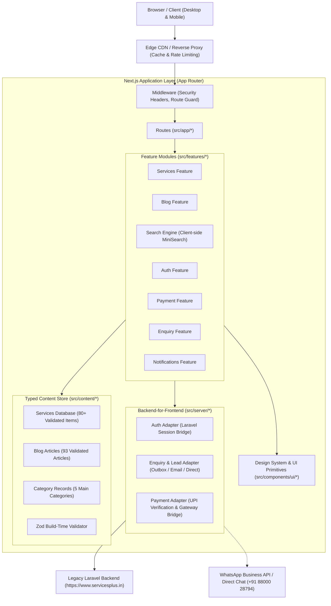
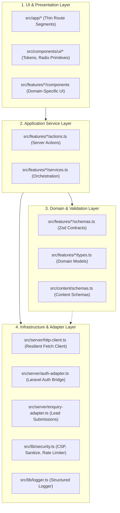

# ServicesPlus Architecture Guide

## Overview

ServicesPlus is rebuilt as a high-performance, secure, and resilient web application using Next.js (App Router), TypeScript, Tailwind CSS, Motion, Radix primitives, and Zod. The architecture follows a **feature-based modular monolith** with strict unidirectional layering:

\`UI (Components/Views) -> Application Services (Use Cases/Actions) -> Domain (Schemas/Models) -> Infrastructure Adapters (BFF/Repositories)\`

---

## 1. System Architecture Diagram

---

## 2. Layered Architecture & Unidirectional Dependencies

**Rule**: Dependencies only point downward. The browser never communicates with the legacy backend directly; all communication is handled server-to-server with strict schema validation.

---

## 3. Directory Layout

\`\`\`
servicesplus/
├── docs/                      # Architectural decisions, security threat models, notes, and inventory
│   ├── adr/                   # Architecture Decision Records
│   ├── inventory.json         # Complete 208-page crawled inventory
│   ├── ARCHITECTURE.md        # This document
│   ├── SECURITY.md            # ASVS Level 2 Threat Model & Controls
│   └── NOTES.md               # Business facts, inconsistencies, owner review items
├── public/                    # Pre-optimized local static assets (never hotlinked)
│   └── assets/
│       ├── blog/              # Blog banners and post figures
│       ├── certificates/      # Trust and accreditation certificates
│       ├── icons/             # Custom SVG and icon assets
│       └── images/            # Brand logos, hero graphics, QR codes
├── src/
│   ├── app/                   # Next.js App Router (Thin route controllers)
│   │   ├── (auth)/            # /user-login, /user-register
│   │   ├── (marketing)/       # /, /about, /contact
│   │   ├── blog/              # /blog, /blog-detail/[slug]
│   │   ├── service/           # /service/[slug] (Universal service template)
│   │   ├── service-by-categories/ # /service-by-categories/[slug]
│   │   ├── policy/            # /policy/privacy-policy, /policy/terms-and-condition
│   │   ├── payment/           # /payment (UPI QR + Step-by-step guidance)
│   │   ├── notification/      # /notification (Compliance updates table)
│   │   ├── api/               # Health (/api/health, /api/ready), search index, webhooks
│   │   ├── layout.tsx         # Root layout with fonts, providers, global nav & footer
│   │   └── error.tsx          # Resilient error boundaries
│   ├── components/
│   │   ├── layout/            # MegaMenu, TopNav, Footer, FloatingWhatsApp, CommandPalette
│   │   └── ui/                # Button, Badge, Card, Dialog, Accordion, Tabs, Input, Tooltip
│   ├── content/               # Typed data store validated at build time
│   │   ├── services/          # 80+ service profiles in structured JSON/TS
│   │   ├── categories/        # 5 core business categories
│   │   ├── blogs/             # 93 complete crawled articles
│   │   └── notifications/     # Regulatory announcements
│   ├── features/              # Feature modules (Domain logic + components + schemas)
│   │   ├── auth/              # Authentication flows and session management
│   │   ├── blog/              # Blog list, article views, related posts
│   │   ├── enquiry/           # Contact forms, lead capture, validation
│   │   ├── payment/           # UPI QR presentation, verification flow
│   │   ├── search/            # Instant command palette search (Cmd+K)
│   │   └── services/          # Service hero, tabs, FAQs, trust badges
│   ├── lib/                   # Shared utilities (env, logger, security, constants)
│   └── server/                # Backend adapters & Anti-Corruption Layer (ACL)
\`\`\`

---

## 4. Key Architectural Decisions

1. **Static Generation + Tagged Revalidation (ISR)**:
   - All 80+ service pages, 5 category landing pages, 93 blog articles, homepage, and policy pages are pre-rendered at build time via \`generateStaticParams()\`.
   - Result: Instant TTFB (<100ms), 100% uptime even if the origin backend is unreachable, and maximum SEO crawl efficiency.

2. **Client-Side Command Palette (MiniSearch / Fuse.js)**:
   - Pre-computed lightweight service catalog search index generated at build time.
   - Searches across title, tags, and category with zero server latency or database strain.

3. **Anti-Corruption Layer (Backend Adapter)**:
   - When the user submits an enquiry or initiates login, the request flows to a Server Action.
   - The action sanitizes and validates inputs with Zod, checks rate limits, and dispatches via \`src/server/backend-adapter.ts\`.
   - If the legacy Laravel API is offline, the enquiry is safely buffered in an outbox and the user receives a graceful confirmation with a 1-click WhatsApp fallback.
